# Architektura Osirisu

Osiris je multi-tenant asistent pro živnostníky a malé firmy (zakázky, termíny, poznámky, nabídky, faktury). Uživatelé s ním mluví přes webový chat a WhatsApp, česky nebo slovensky. Tento dokument popisuje, z čeho se systém skládá, jak spolu části mluví, kde leží data a jak je zajištěná bezpečnost a provoz.

Podrobnosti pro vývoj jsou v [CLAUDE.md](../CLAUDE.md), postup nasazení a provozu v [deploy/README.md](../deploy/README.md).

## Hlavní principy

- **Každý tenant má vlastní kontejner.** Agent tenanta běží v samostatném podu v jeho vlastním namespace, s vlastní databází a soubory na vlastním svazku. Tenanti se nevidí ani po síti.
- **Nečinný tenant spí.** Runtime tenanta se po nastavené době nečinnosti zazálohuje a vypne (scale-to-zero). Probudí ho další požadavek, zpráva z WhatsAppu nebo naplánovaná úloha.
- **Přihlašování zajišťuje Osiris sám.** Control je poskytovatel identity (OpenID Connect) na `osiris.k6labs.cz/auth`: hesla, klíče (passkeys), účty Google, Facebook a Microsoft, dvoufázové ověření. Uživatelé a jejich claimy (kdo kam patří) jsou v centrální databázi. PocketID v clusteru zůstává pro jiné služby.
- **Jediný vstup z internetu.** Na `osiris.k6labs.cz` odpovídá jen gateway. Ostatní služby jsou dostupné jen uvnitř clusteru a jen tomu, komu to síťové politiky dovolí.
- **Nejmenší možná oprávnění.** Přihlašovací klíče a údaje uživatelů má jen control, ke Kubernetes API jen operátor (a control pro objekty `Tenant`), klíče k S3 jen control a sites. Runtime tenanta nedrží žádný sdílený klíč.

## Komponenty

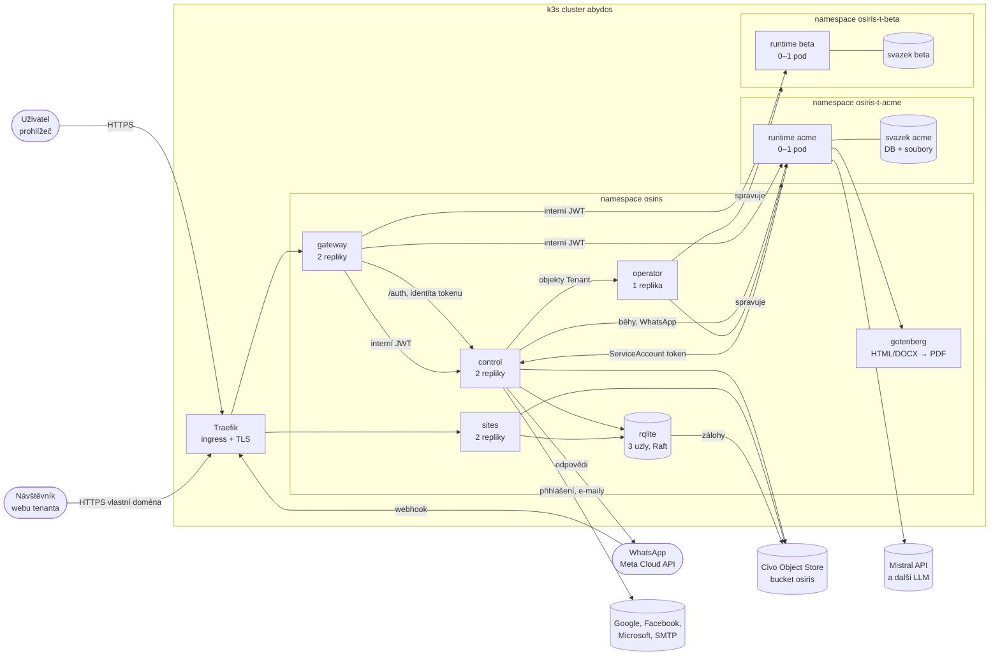

| Služba | Úloha | Data a klíče |
|---|---|---|
| **gateway** | Jediný vstup pro `osiris.k6labs.cz`. Přihlašování (`/auth`) předává do control, u API se control zeptá, komu access token patří, spočítá z claimů členství a pošle požadavek do control nebo do runtime aktivního tenanta. Spící runtime probudí. Servíruje webovou aplikaci, nastavuje bezpečnostní hlavičky (CSP) a limity požadavků. | Soukromý klíč pro interní JWT |
| **control** | Řídicí rovina: přihlašování (OIDC provider), uživatelé a jejich přihlašovací údaje, tenanti, správa členů, WhatsApp, plánovač úloh, domény a publikace webů, zálohy tenantů. Zapisuje objekty `Tenant` pro operátora. | rqlite, S3, podepisovací klíč ID tokenů, klíče Google/Facebook/Microsoft, SMTP, WhatsApp token |
| **operator** | Z objektů `Tenant` udržuje namespace tenantů: StatefulSet s runtime, svazek, síťové politiky, kvóty, ingressy pro domény. Uspává nečinné tenanty a budí je na požádání. | Master klíč pro odvození klíčů tenantů |
| **runtime** | Agent jednoho tenanta (LangGraph): chat, znalostní báze, dovednosti, paměť, MCP, tajemství, soubory. Interní rozhraní pro control a operátora. | Databáze a soubory tenanta na jeho svazku, klíč tenanta pro tajemství |
| **sites** | Statický server pro weby tenantů na jejich vlastních doménách. | rqlite (jen čtení), S3 |
| **gotenberg** | Převod HTML a dokumentů Office do PDF. Bez přístupu ven. | žádná |
| **rqlite** | Centrální databáze (SQLite replikované přes Raft). | Svazky uzlů, automatické zálohy do S3 |

### Sdílené balíčky

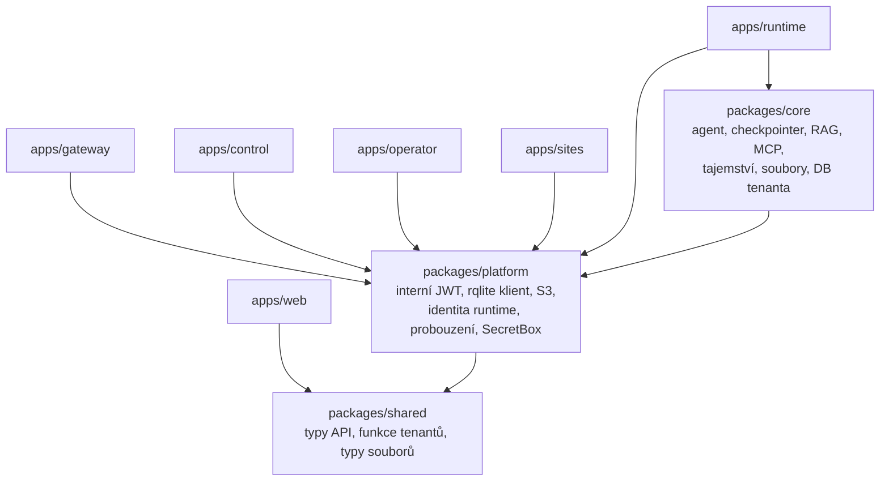

Všechny balíčky se importují jako zdrojový TypeScript (`@osiris/<balíček>/<cesta>.ts`) bez build kroku. Služby spouští `tsx`, každá má vlastní Docker image (`ghcr.io/richardblaha/osiris-<služba>`).

## Identita a přístup

Uživatelé jsou v centrální databázi (tabulka `users`), jejich oprávnění jako claimy:

| Claim | Význam |
|---|---|
| `role=osiris-user` | Smí používat Osiris (bez něj 403) |
| `role=osiris-admin` | Správce systému: správce všech tenantů, zakládá a ruší tenanty |
| `tenant=<slug>` | Uživatel tenanta (může jich být víc, oddělených čárkou) |
| `tenant-admin=<slug>` | Správce tenanta |
| `phone_number` | Ověřené telefonní číslo pro WhatsApp |

Claimy jmenující neexistujícího nebo archivovaného tenanta se ignorují. Správce tenanta zve lidi e-mailem: existující uživatel se připojí, nový se založí a dostane jednorázový přihlašovací odkaz. Registrace bez pozvánky není. Telefon si uživatel ověří sám tak, že ze svého čísla pošle na WhatsApp Osirisu zprávu `OVERENI <kód>`.

### Přihlášení

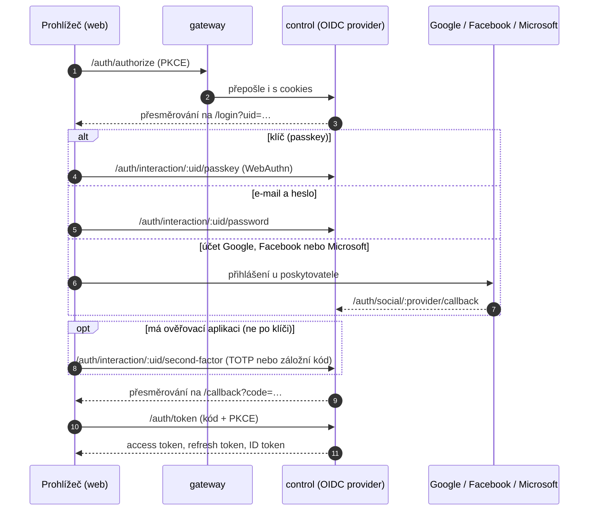

- **Způsoby přihlášení:** klíč (passkey) s ověřením uživatele na zařízení je sám o sobě dvoufázový. Po hesle, účtu Google/Facebook/Microsoft nebo jednorázovém odkazu se uživatel s ověřovací aplikací ptá ještě na kód (nebo záložní kód). Hesla jsou uložená jako argon2id, tajemství TOTP zašifrovaná.
- **Účty u poskytovatelů:** Google a Facebook ručí za e-mail, takže pozvaný člověk se jimi přihlásí rovnou. Účet Microsoft si uživatel musí nejdřív propojit v profilu.
- **Jednorázové odkazy** (pozvánka, odkaz od správce, „zapomenuté heslo“ e-mailem) se spotřebují až při přihlášení, ne otevřením, takže je nespálí skenery pošty.
- **Ochrana:** omezení neúspěšných pokusů na účet, adresu a přihlášení; každý krok přihlášení je svázaný s cookie prohlížeče, který ho začal.
- **Session:** přihlášení platí 30 dní, refresh token se při každém použití mění a končí s odhlášením. Access token je neprůhledný a gateway se na něj ptá control (výsledek drží minutu).

### Důvěra mezi službami

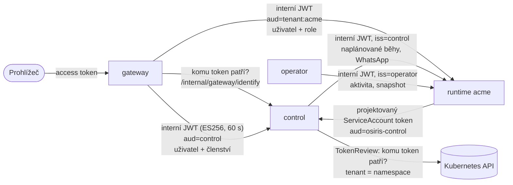

- **Prohlížeč → gateway:** OIDC access token vydaný control. Dál než do gateway (a k ověření do control) se nedostane.
- **Gateway, control, operátor → ostatní služby:** krátký interní JWT (ES256, 60 s). Nese ověřeného uživatele, jeho roli v tenantovi a kanál. Audience je `control`, nebo `tenant:<slug>`, takže token pro jednoho tenanta je u jiného k ničemu. Runtime má jen veřejný klíč.
- **Runtime → control:** projektovaný ServiceAccount token s audience `osiris-control`. Control se Kubernetes API zeptá (TokenReview), komu patří, a tenanta určí z namespace `osiris-t-<slug>`, nikdy z obsahu požadavku. Runtime tak může jednat jen za svého tenanta.
- **Tajemství tenantů** (API klíče, hlavičky MCP serverů) jsou zašifrovaná klíčem tenanta odvozeným z master klíče (HKDF). Únik z podu jednoho tenanta neodhalí tajemství ostatních.

## Tok požadavku z webu

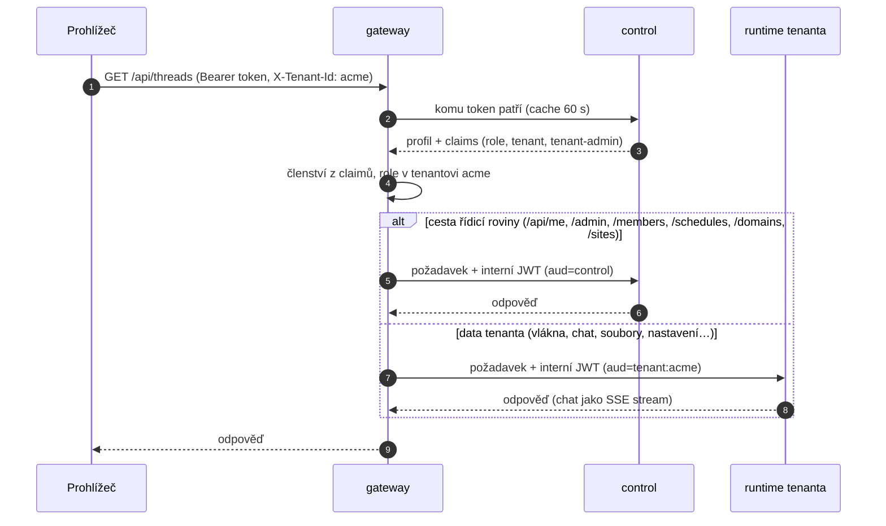

Chat posílá jen novou zprávu uživatele. Historii drží runtime v checkpointeru a odpověď agenta se streamuje přes gateway jako server-sent events.

## Agent

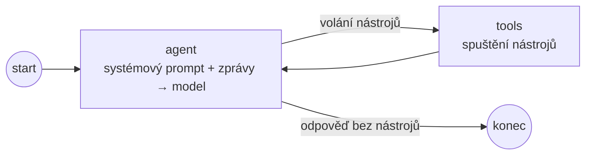

Agent je ručně postavená ReAct smyčka v LangGraphu (`StateGraph` nad `MessagesAnnotation`). Modely a nástroje dodává LangChain (`initChatModel`, `@langchain/core`, `@langchain/mcp-adapters`). Systémový prompt se skládá při každém volání z pravidel, formátu kanálu, data a času, seznamu dovedností, souborů, paměti, názvů tajemství a profilu uživatele, a do checkpointu se neukládá.

Nástroje se vybírají při každém kroku podle zapnutých funkcí tenanta:

| Funkce | Nástroje |
|---|---|
| `knowledge` | `search_knowledge` (vektorové hledání v libSQL) |
| `skills` | `load_skill` |
| `memory` | `remember`, `forget` |
| `files` | `list_files`, `read_file`, `write_file`, `delete_file`, `move_file`, `render_template`, `resize_image`, `convert_to_pdf` |
| `http` | `http_request` (s ochranou proti SSRF a doplňováním tajemství) |
| `mcp` | nástroje registrovaných MCP serverů (`<server>_<nástroj>`) |
| `scheduler` | `schedule_task`, `list_schedules`, `cancel_schedule` |
| `sites` | `publish_site` |

Identitu a roli uživatele berou nástroje vždy z kontextu běhu, nikdy z argumentů modelu.

## Probouzení a uspávání tenanta

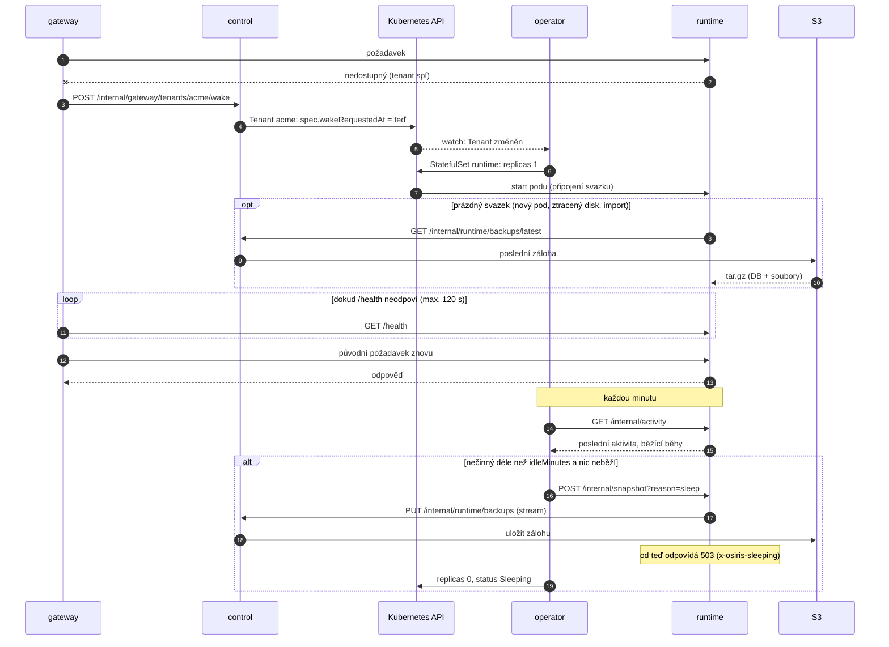

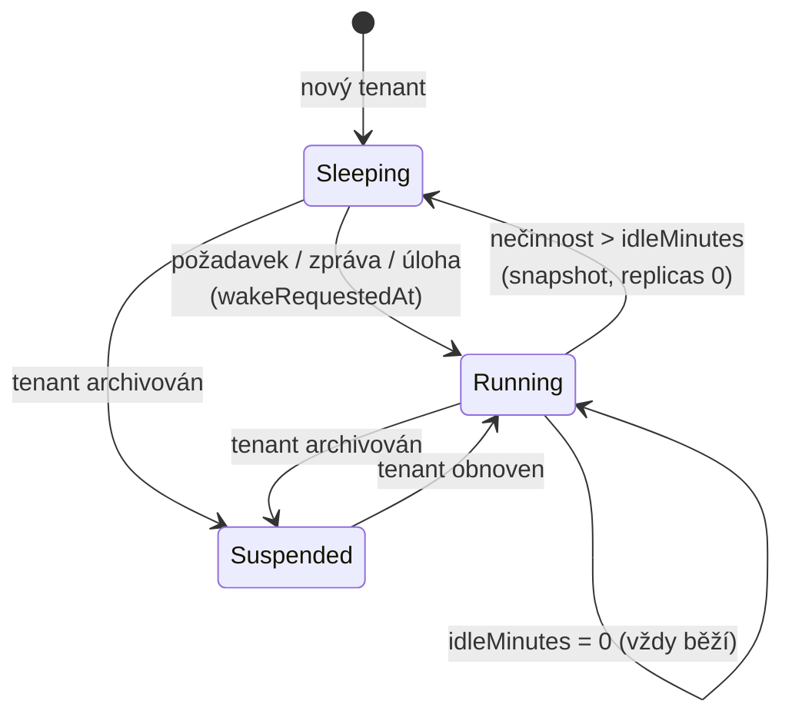

Svazek tenanta zůstává i ve spánku, takže probuzení obvykle trvá jen pár sekund. Delší je jen první start, kdy se zakládá svazek. Gateway mezitím drží požadavek otevřený.

## Data

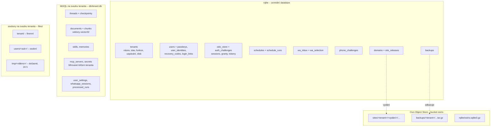

- **rqlite** drží jen to, co sdílí služby: seznam tenantů a jejich nastavení, frontu WhatsApp zpráv, rozvrhy úloh, domény a vydání webů, evidenci záloh. rqlite nemá interaktivní transakce. Fronty se proto zabírají jedním podmíněným `UPDATE` s claim tokenem a časy předává aplikace jako parametr.
- **Data tenanta** (konverzace, znalostní báze, dovednosti, paměť, MCP servery, tajemství, nastavení) jsou v jeho vlastní libSQL databázi a nikdy neopustí jeho svazek, kromě záloh.
- **Soubory** mají tři rozsahy: firemní (zapisuje správce), osobní a dočasné soubory konverzace. Úložiště hlídá cesty, typy souborů podle obsahu, velikost a kvótu.
- **S3** obsahuje publikované weby, zálohy tenantů (před každým uspáním, denně a na vyžádání; drží se 30 dní, nejméně 3 poslední) a zálohy rqlite (každých 5 minut, když se něco změnilo).

## WhatsApp

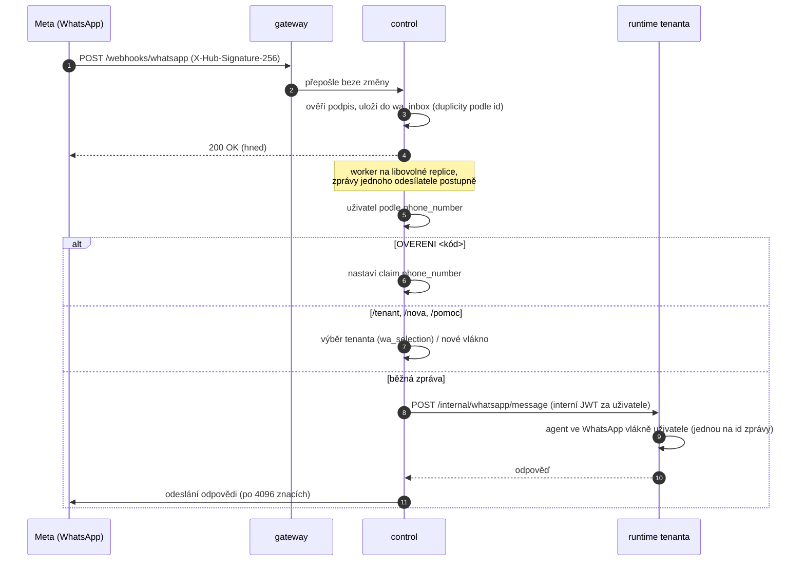

Runtime tenanta WhatsApp token nemá, posílá jen control. Uživatel ve více tenantech si přepíná příkazem `/tenant <zkratka>`. Když je runtime nedostupný, zkusí to worker znovu a nakonec odpoví omluvou.

## Plánované úlohy

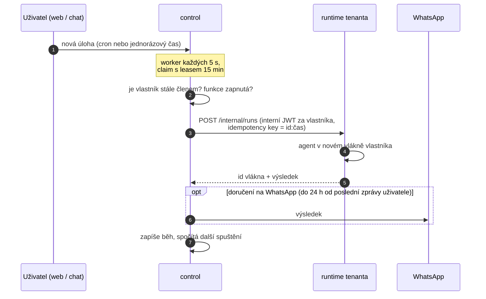

Úloha běží s oprávněními svého vlastníka. Běh zpožděný o víc než hodinu se přeskočí, chyby se třikrát zopakují. Opakovaný požadavek se stejným klíčem runtime odbaví ze záznamu a agenta znovu nespustí.

## Weby tenantů

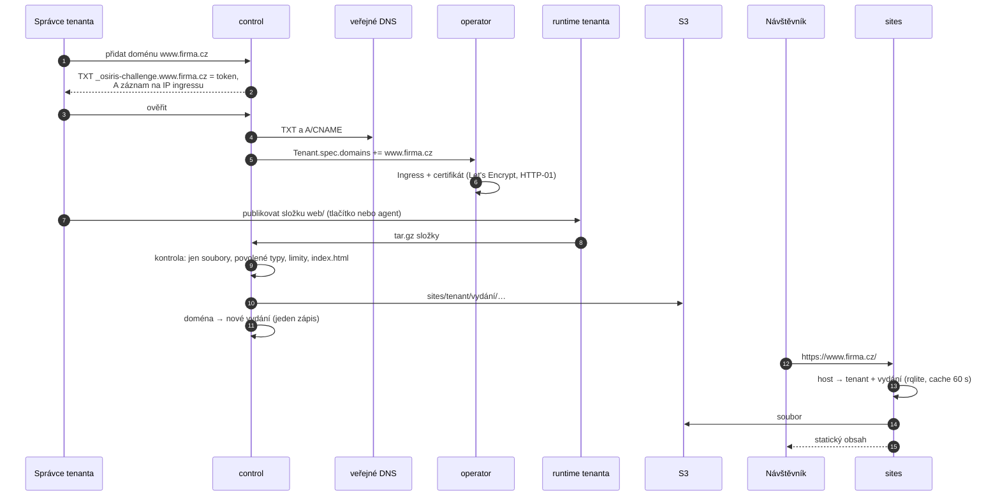

Doménu, která přestane mířit na Osiris, control při pravidelné kontrole (každých 6 hodin) vypne. Ponechává se posledních 5 vydání a k předchozímu se dá vrátit.

## Bezpečnost

### Síťové politiky

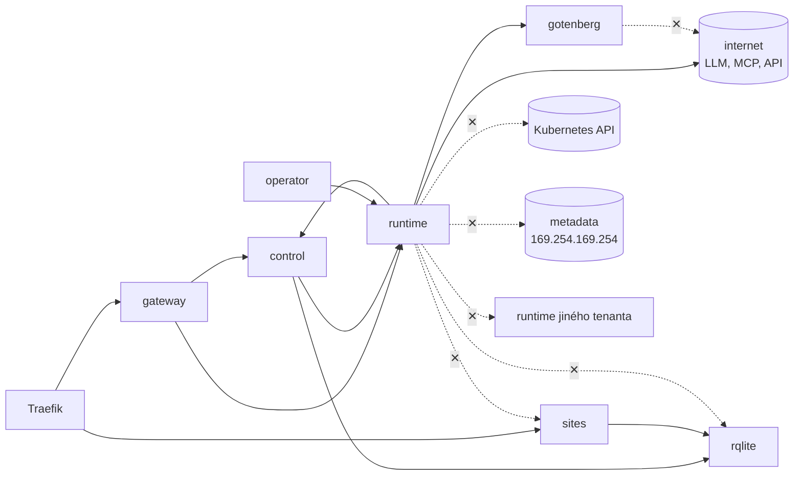

- V namespace `osiris` je výchozí zákaz příchozího provozu a povolené jsou jen šipky výše. Namespace tenanta má výchozí zákaz v obou směrech: runtime přijímá provoz jen od gateway, control a operátora a ven smí jen do DNS, control, Gotenbergu a internetu mimo privátní rozsahy. Vynucuje to Cilium. Izolace je ověřená přímo z podu tenanta.
- **Pody** běží bez roota, s read-only root FS, bez capabilities, se seccomp profilem a bez automaticky připojeného tokenu (kromě control a operátora). Namespace tenantů vynucují Pod Security `restricted`.
- **Agent** nespouští žádný kód. Jen pevně dané nástroje, šablony Mustache bez logiky, PDF přes izolovaný Gotenberg. `http_request` a MCP smí jen na veřejné https adresy, tajemství se doplňují jen pro povolené hosty a ve výstupu se maskují.
- **Soubory** se stahují vždy jako příloha s `nosniff` a sandbox CSP, takže HTML nebo SVG tenanta se nikdy nevykreslí na doméně Osirisu. Weby tenantů běží na jejich vlastních doménách.
- **Gateway** omezuje velikost požadavků a počet požadavků a běhů agenta na uživatele a nastavuje CSP, HSTS a zákaz vkládání do rámců.

## Nasazení

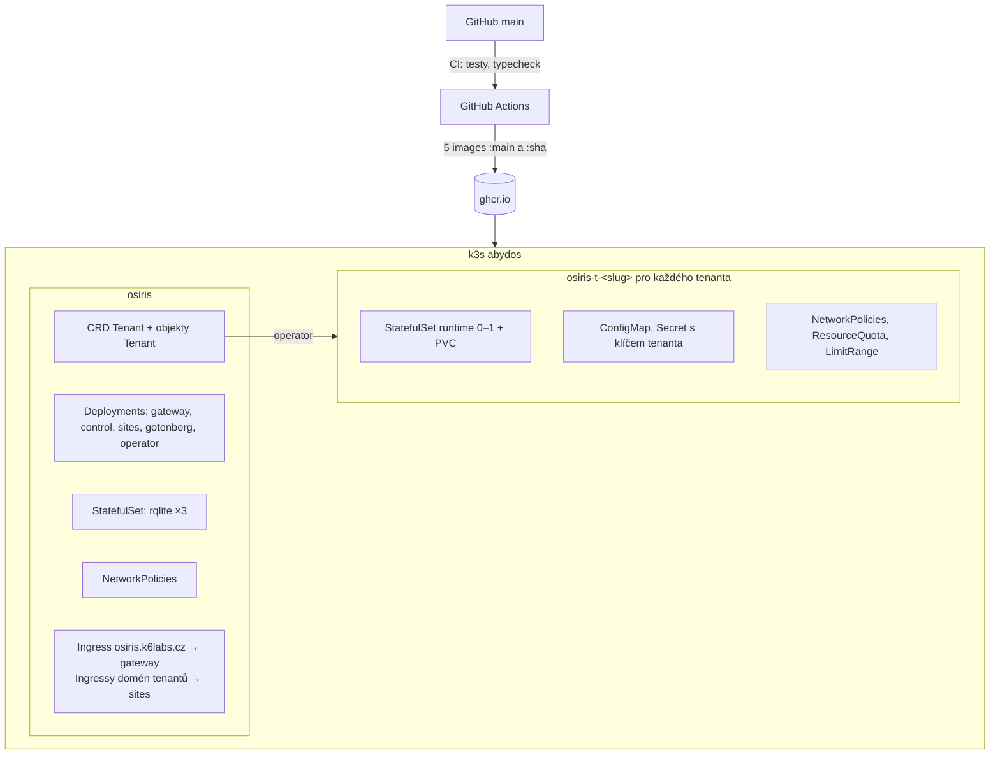

Manifesty jsou v `deploy/k8s` (kustomize). Runtime tenantů vytváří operátor a při každém probuzení stahují aktuální image. Nová verze se tak k tenantovi dostane při jeho dalším probuzení.

## Lokální vývoj

Lokálně běží stejné služby bez Kubernetes: control místo rqlite použije soubor SQLite (i pro uživatele), místo S3 složku, e-maily vypisuje do logu a runtime tenantů spouští jako podprocesy (`ORCHESTRATOR=local`). Gateway může přihlašování přeskočit (`AUTH_DEV_BYPASS`); prvního správce založí `pnpm --filter @osiris/control users add-admin <e-mail>`. `pnpm dev` spustí gateway, control, sites a web, runtime si control spustí sám při prvním požadavku na tenanta.
